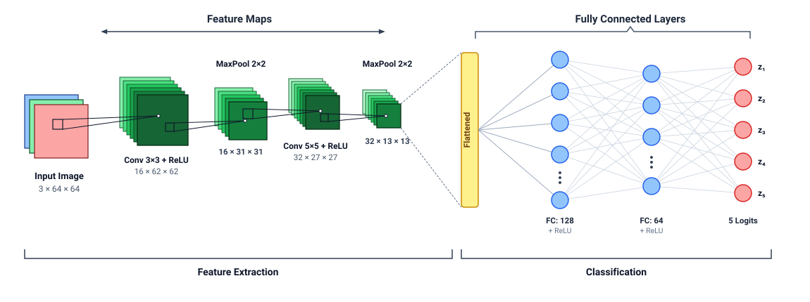
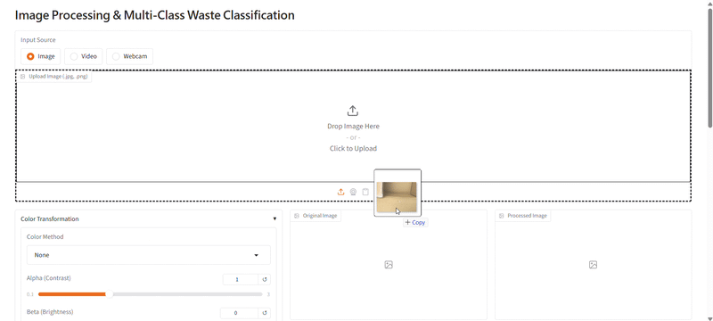

# README

A CNN model for garbage classification using Pytorch.

## How to run

1. Create a virtual environment and install the required packages from `requirements.txt`:

    ```bash
    python -m venv venv
    source venv/bin/activate  # On Windows use `venv\Scripts\activate`
    pip install -r requirements.txt
    ```

2. Run the `main.ipynb` notebook to train and evaluate the model.

    Download the model weights to `source/weights/` after training.

3. Run the UI application with the following command:

    ```bash
    cd source
    gradio app.py
    ```

## Dataset

Detailed Vietnamese description of the dataset can be found in [dataset_description.md](source/dataset_description.md).

## Architecture

CNN model with 2 convolutional layers, 2 max pooling layers, and 3 fully connected layers with ReLU activation functions.

The model is designed to classify images into 5 classes: cardboard, glass, metal, paper, and plastic.



The jupyter notebook `main.ipynb` is downloaded from my project on [kaggle](https://www.kaggle.com/code/tuanannguyen/garbage-classification-main)

## Application

Application UI is built using Gradio, which allows users to interact with the model through a web interface.

The UI provides options to upload images or videos or webcam, apply preprocessing, and view the classification results.

### Application Architecture



### UI demonstration


